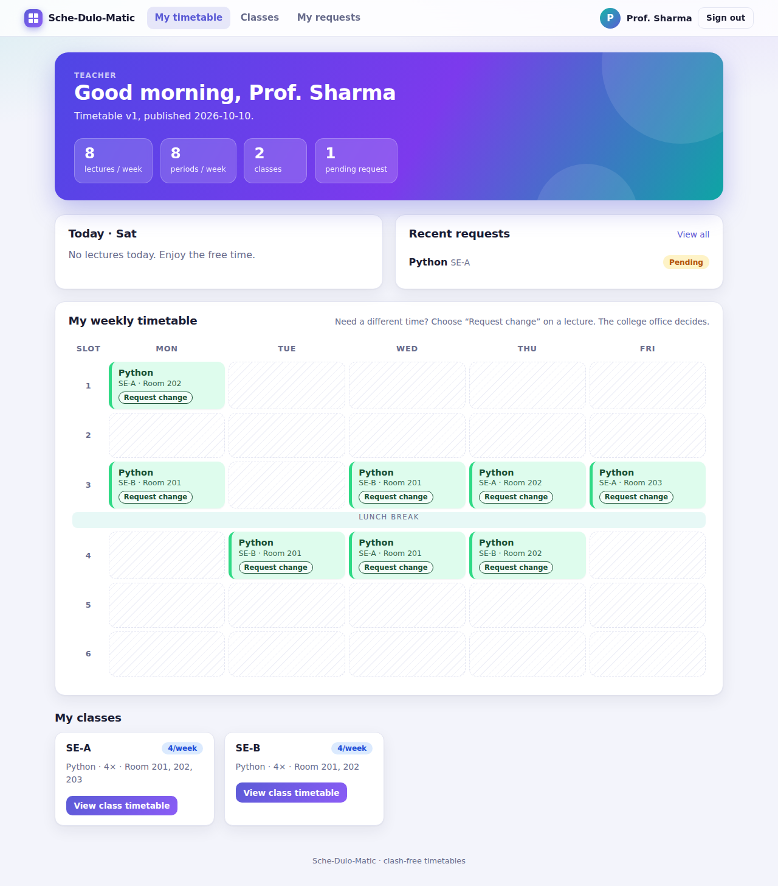
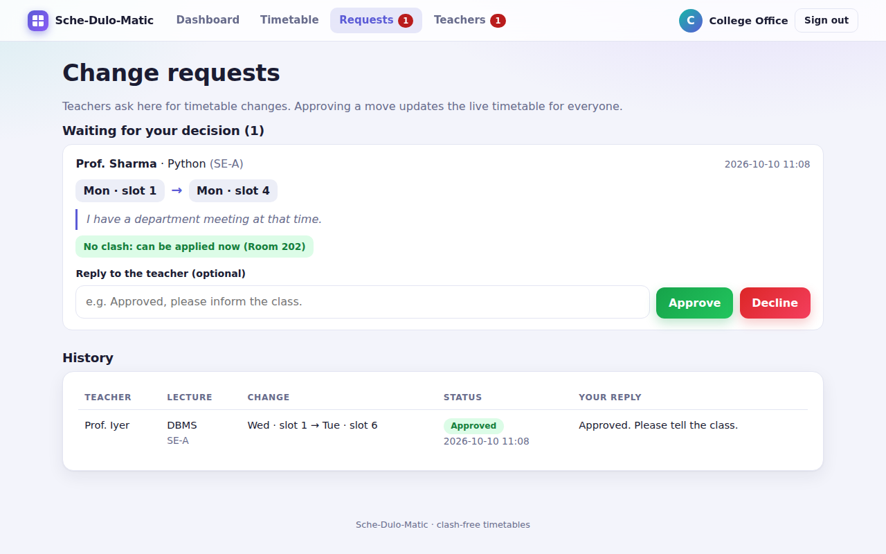

# 🗓️ Sche-Dulo-Matic

A **timetable generator and web portal** for a college or school.
The office publishes a clash-free timetable, teachers sign in to see **their lectures and classes**,
and they can **ask for changes**. Each request goes to the office, which approves or declines it.

| Teacher dashboard | Office inbox |
|---|---|
|  |  |

*(Screenshots use demo data.)*

## What it does
**Timetable engine** (Python, OOP)
- Builds weekly timetables for several classes at once, with no teacher, room or class ever double-booked
- Labs take 2 consecutive periods in lab rooms and never cross the lunch break
- Greedy placement + randomized restarts, with an independent clash checker

**Web portal** (Flask, SQLite, hand-written HTML/CSS, light and dark themes, mobile friendly)
- **Teachers:** sign up, wait for approval, sign in, see today's lectures, the weekly timetable, every class they teach,
  and any other class (view only)
- **Change requests:** the teacher clicks "Request change" on a lecture. Only time slots with **no clash** (for the teacher, the
  class and a room) are offered. The office sees the request with a live clash check, then approves or declines with a reply.
  **Approving moves the lecture in the live timetable.** The teacher sees the decision in their account.
- **Office / admin:** publish a timetable (sample, upload a JSON file, or regenerate), view any class or teacher timetable,
  approve teacher accounts, answer requests

## Quick start
```bash
python -m venv .venv && source .venv/bin/activate        # Windows: .venv\Scripts\activate
pip install -r requirements.txt
python manage.py demo        # creates DEMO data and demo accounts (prints the logins)
python manage.py run         # open http://127.0.0.1:5000
python -m unittest discover -s tests
python main.py               # command-line version: prints timetables and writes CSV files
```
Demo logins (demo only): office `admin@college.test` / `Admin@1234`, teacher `sharma@college.test` / `Teacher@1234`
(also `iyer@` and `khan@college.test`). `rao@college.test` is waiting for approval so you can try that screen.

### Using it for real
1. `python manage.py create-admin` creates the office account (asks for a password).
2. Sign in as the office, open **Timetable** and upload a JSON configuration (see `data/sample.json`).
3. Teachers go to **Create your account**, choose their name from the timetable, and wait.
4. The office approves them under **Teachers**. From then on, change requests arrive under **Requests**.

## How a change request works
```
Teacher clicks "Request change" ──► form lists only clash-free slots (moves.available_moves)
        │ submit (validated again on the server)
        ▼
 Office inbox: request + live check (moves.check_move) ──► Approve ──► lecture moved, teacher notified
                                                       └─► Decline ──► teacher sees the reply
```
Approval re-checks the move at that moment, so a stale request can never create a clash. If the office regenerates the timetable,
pending requests are closed automatically (they referred to the old one).

## Security (what is built in)
- Passwords are **hashed** (Werkzeug scrypt), never stored; sign-in errors don't reveal whether an email exists
- **CSRF protection** on every form, SQL is parameterised, templates auto-escape (user text can't inject HTML)
- **Role checks** on every page (teachers get 403 on office pages), accounts need **office approval**, a revoked account loses access immediately
- A teacher can only request changes to **their own** lectures; tampered form values are rejected
- Secure cookie settings, a Content-Security-Policy with no scripts at all, upload size limit
- Set `COOKIE_SECURE=1` and serve over HTTPS in production; `SECRET_KEY` can come from the environment
  (otherwise a random one is generated into `instance/`)

## Project structure
```
sche-dulo-matic/
├── schedulomatic/          # timetable engine
│   ├── models.py  scheduler.py  loader.py  exporter.py
│   └── moves.py            # rules for moving one lecture (used by requests)
├── webapp/                 # Flask website
│   ├── __init__.py         # app factory, security headers, error pages
│   ├── auth.py  teacher.py  admin.py      # the three areas
│   ├── services.py         # publish timetable, build grids, queries
│   ├── security.py  db.py  # CSRF, login/role checks, SQLite schema
│   ├── templates/          # Jinja pages
│   └── static/style.css    # all the styling
├── manage.py               # create-admin / demo / run
├── main.py                 # command-line generator
├── data/sample.json
└── tests/                  # engine, move rules, and web flow
```

## Limitations and ideas
- No email notifications (decisions appear in the portal); add SMTP or push notifications
- No login rate-limiting or password reset yet; a real deployment should add both
- The office can't hand-edit the timetable; add drag-and-drop editing and swap requests between two teachers
- SQLite is fine for one college; move to PostgreSQL/MySQL for many concurrent users
- Greedy scheduling isn't provably optimal (a constraint solver such as OR-Tools would be)

## Author

**Maheshree Katla**
B.E. Computer Engineering | Aspiring Python / AI-ML Developer
